# Kilter climb generator

Can a model read a Kilter Board climb and tell how hard it is? And can one set
new climbs at a grade you ask for?

Part 1 answers the first question with two grade predictors, gradient
boosting and a graph neural network, trained on about 72,000 community-graded
climbs. Part 2 trains a small GPT that writes new climbs for a requested grade
and wall angle, and uses the graph model to check whether they come out at
that grade.

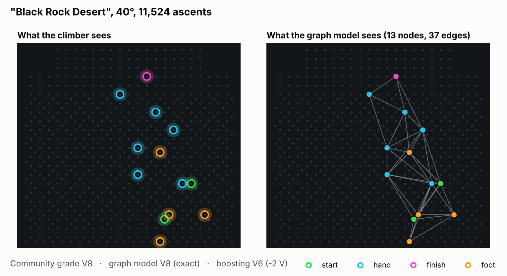

## Part 1: Predicting grades

The graph model grades **82% of unseen climbs within one V-grade** and is off
by 0.84 grades on average. Knowing only the wall angle gets 45%.

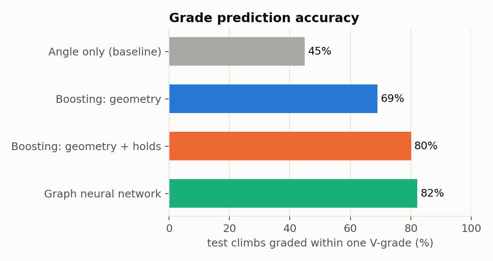

| Model (test set, 8,759 climbs) | Avg. error | Exact V-grade | Within ±1 V |
|---|---|---|---|
| Angle only (baseline) | 1.95 V | 17% | 45% |
| Boosting: geometry | 1.16 V | 29% | 69% |
| Boosting: geometry + hold difficulty | 0.89 V | 37% | 80% |
| **Graph neural network** | **0.84 V** | **39%** | **82%** |

What stands out:

1. **Which holds a climb uses matters more than its shape.** Adding one number
   per hold ("how much harder are climbs that use this hold?") lifted boosting
   from 69% to 80%. It is the most important feature, ahead of the wall
   angle. The graph model learns the same thing on its own, from a learned
   vector per board position.
2. **The graph model's advantage is on hard climbs.** Up to V6 the two models
   are tied. From V8 to V11, boosting's error rises to about 1.5 grades while
   the graph model stays near 1. Hard climbs seem to depend on how moves
   combine, which a graph sees and a list of summary numbers does not.
3. **Part of the remaining error is in the labels.** Both models agree better
   with climbs logged by 100+ people than with climbs logged by 3 or 4. Some of
   the "error" is the model disagreeing with a grade the community hasn't
   settled yet.

<p>
  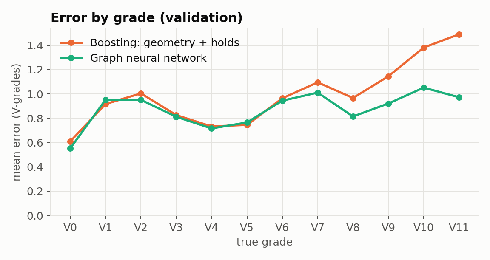
  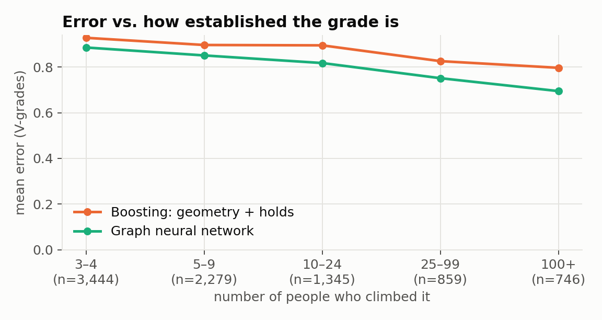
</p>

### Sample predictions

Fifteen climbs from the test set, all with at least 20 ascents. The top two
rows are hand-picked hits, one per grade from V1 to V10. The bottom row shows
cases where the models disagree or both miss. They are examples, not a random
sample: the graph model gets the exact grade on 39% of all test climbs.

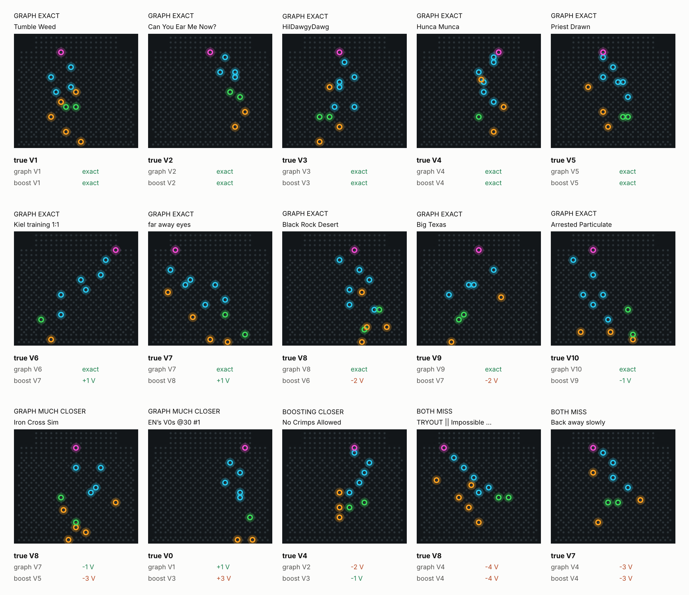

### How the grade models work

Every model predicts Kilter's numeric difficulty (10 = V0 up to 31 = V14;
about 2 points per V-grade) from the holds and the wall angle. Data is split
by climb, so a climb seen at 40° in training never shows up at 30° in testing.

**Boosting on geometry** (`kilter/features.py`). Trees need one fixed-length
row per climb, so each climb is summarised as 23 numbers: hold counts, height
and width, the size of moves between consecutive hand holds, how far each hand
hold is from the nearest foothold, and whether the start is matched.

**Boosting plus hold difficulty** (`kilter/hold_stats.py`). The dataset has
hold positions but not hold shapes. On the Kilter Original, though, every
position always has the same physical hold, so each position can be scored by
how hard the climbs that use it tend to be (target encoding). To avoid leaking
a climb's own grade into its features, training climbs are scored out-of-fold.

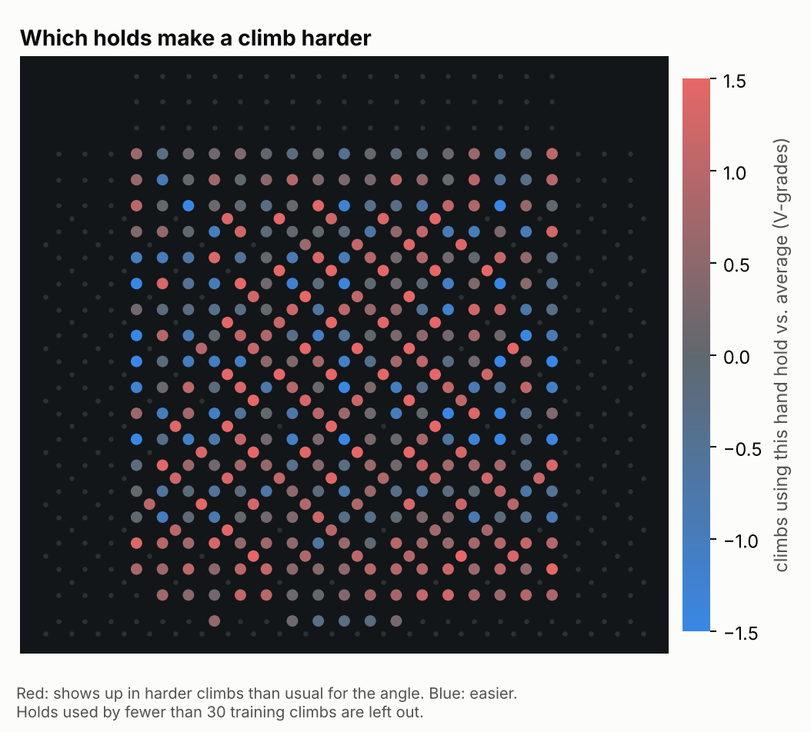

The offset diagonal grid lights up red. Those positions are a separate hold
set in the database, most likely the small screw-on holds. Climbs that use
them as hand holds average 1.4 V-grades harder than usual for their angle.

**Graph neural network** (`kilter/graph.py`, plain PyTorch).

- **Nodes** are holds: position, role (start, hand, finish, foot) and a learned
  32-number vector for that board position.
- **Edges** join holds within reach of each other (7 holes apart), plus each
  hold's two nearest neighbours. Every edge carries the move: how far across,
  how far up, and the distance.
- **Three rounds of message passing.** Each hold collects messages from its
  neighbours and updates itself, so after three rounds it knows about the
  moves around it.
- **Readout:** average and maximum over all holds, plus the angle, go through
  a small network that outputs the difficulty.
- 223k parameters, 25 epochs, about 20 minutes on a 2-core CPU.

## Part 2: Generating climbs

A 2.1M-parameter GPT writes a climb hold by hold, given an angle and a grade.
Below: one climb for each of five requests at 40° and 25°. Each is a random
pick among the climbs that pass the plausibility checks and aren't near copies
of a real climb; none are hand-picked. Red labels mean the graph model thinks
the climb is two or more grades off the request.

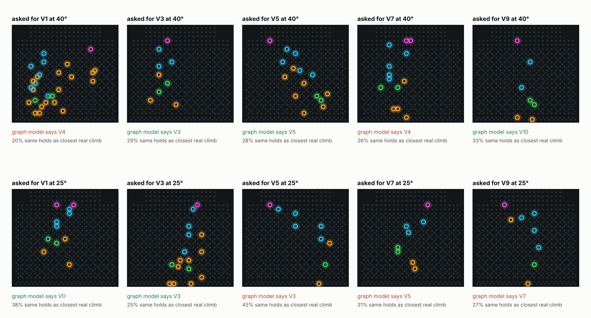

Results on 1,320 generated climbs (60 per grade from V0 to V10, at 25° and
40°), next to real test climbs as a reference:

| | Generated | Real test climbs |
|---|---|---|
| Passes all plausibility checks | 93% | 96% |
| Exact copy of a training climb | 0% | 2.7% |
| 80%+ of holds shared with a training climb | 0% | 7.9% |
| Holds shared with the closest training climb (median) | 29% | 31% |
| Graph model's grade within one V-grade of the request (generated) or true grade (real) | 68% | 82% |

What stands out:

1. **It learned the format.** Without any rules, 87% of what the model writes
   is a well-formed climb: only holds, no position twice, 1–2 starts and 1–2
   finishes. The sampling rules (below) fix the other 13%.
2. **It isn't copying.** None of the 1,320 climbs is an exact or near copy of a
   training climb. Its climbs share about as many holds with their closest
   training climb as real new climbs do (29% vs. 31%). Kilter users actually
   copy more than the model does. Keeping the epoch-7 checkpoint, from before the
   model started memorising, likely helps.
3. **Grade control works, but drifts toward the middle.** 68% of climbs land
   within one grade of the request. If the request were ignored, that would
   be 26%; 82% is roughly the ceiling, since that is how often the graph
   model agrees with the real grade of real climbs. Requests for V0–V3 come
   out about a grade harder, and V6–V10 about a grade easier. Part of the top
   end is the checker itself, which also grades real V9–V10 climbs a grade low.
4. **Temperature 0.8 works best.** On requests for V2–V8 at 40°, it gives 98%
   plausible and 79% within one grade, against 98% and 73% at the default 1.0
   used everywhere else. Above 1.0 quality drops quickly, and it
   buys nothing, because climbs are already new at every temperature.

<p>
  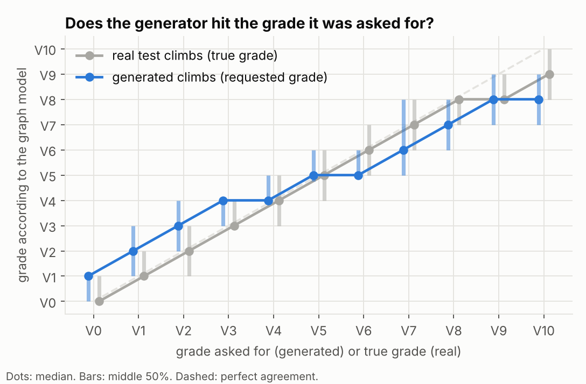
  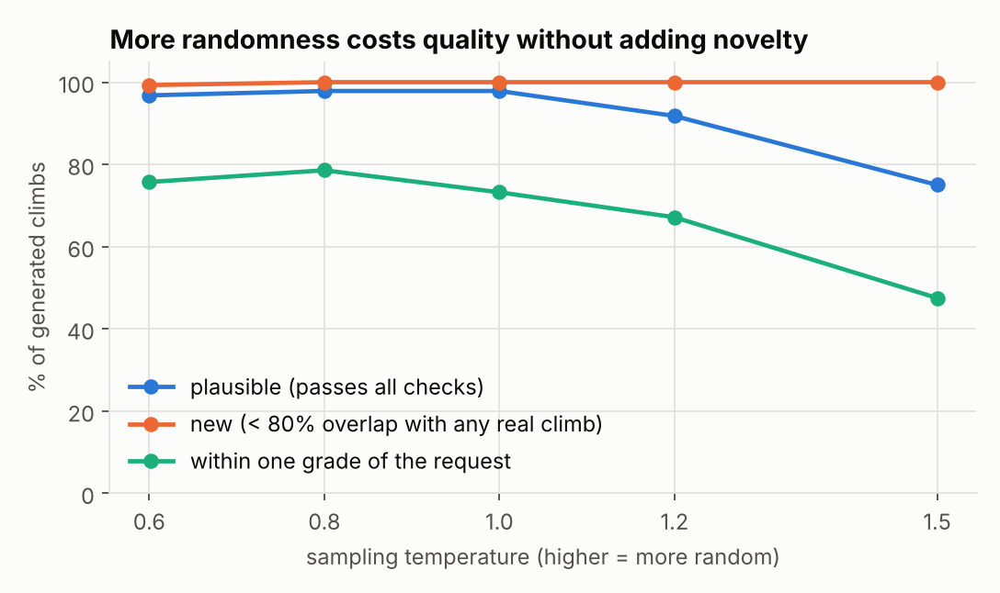
</p>

Limits: every number here comes from models and statistics, not from
climbers. "Plausible" means the climb looks like real ones on six
measurements; it doesn't mean the moves flow or the climb is fun. The real
test is to set a few in the Kilter app (every generated climb, with its holds,
is in `results/generated_climbs.jsonl`) and climb them.

### How the generator works

Each climb becomes a short "sentence" (`kilter/tokenizer.py`):

```
<bos> angle=40 V3 1096:foot 1113:foot 1131:foot 1149:start 1166:foot 1200:hand ... 1392:finish <eos>
```

One token is one lit-up hold: a board position plus its role, ordered bottom
to top. The vocabulary has 1,709 tokens and a climb averages 17.

- **Model** (`kilter/gpt.py`): a decoder-only transformer like GPT-2, but
  small: 4 layers, 4 attention heads, 192 dimensions. It learns only to
  predict holds and the end of the climb; the angle and grade are given.
- **Training** (`train_generator.py`): 12 epochs on the 72k training climbs.
  Validation loss bottomed out at epoch 7; after that the model only got
  better at reproducing training climbs, so epoch 7 is kept.
- **Sampling** (`kilter/sampling.py`): prompt with `<bos> angle=25 V3` and
  sample one hold at a time. Some choices are blocked: a position already
  used, a hold below the previous one, a third start or finish, or ending
  before there is a start and a finish.
- **Checks** (`kilter/climb_checks.py`): *plausible* means six measurements
  (hold count, hand-hold count, largest hand move, start height, finish
  height, start-to-finish height) fall in the range of 98% of real climbs.
  *Overlap* is the share of holds two climbs have in common (Jaccard), against
  the closest of the 42k distinct training climbs.

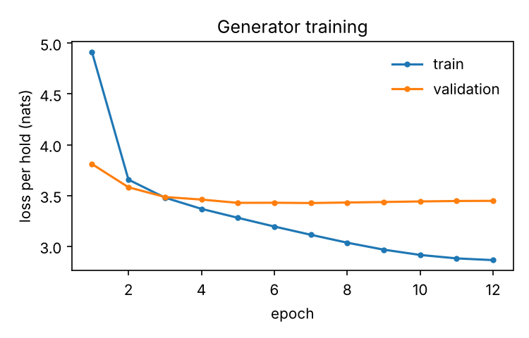

## Setter Lab: try it yourself

A small app that runs on your own computer (desktop browser) on top of both
models:

- **Set a climb:** click holds on the board to cycle start → hand → finish →
  foot → off, pick the wall angle, and the graph model grades it as you go. It
  also runs the plausibility checks and names the closest real climb.
- **Generate:** pick a grade, angle and how random to be. The GPT writes 48
  climbs in about a second, and the app shows the plausible ones closest to
  the requested grade first.
- **Max hand gap:** enter your height and wingspan. The app shows your ape
  index and takes a share of your wingspan (⅔ by default, a rough starting
  point, not a measured rule) as the biggest gap between consecutive hand
  holds you can comfortably do. Every climb shows its biggest gap as a dashed
  line, the generator can be told never to exceed your max, and the app shows
  what share of real climbs at that grade fit under it. The cm values assume
  Kilter's board coordinates are inches.
- **Saved:** keep climbs you want to set in the Kilter app later (stored in
  your browser).

```bash
python app.py   # opens http://localhost:8765; needs models/ and data/processed/
```

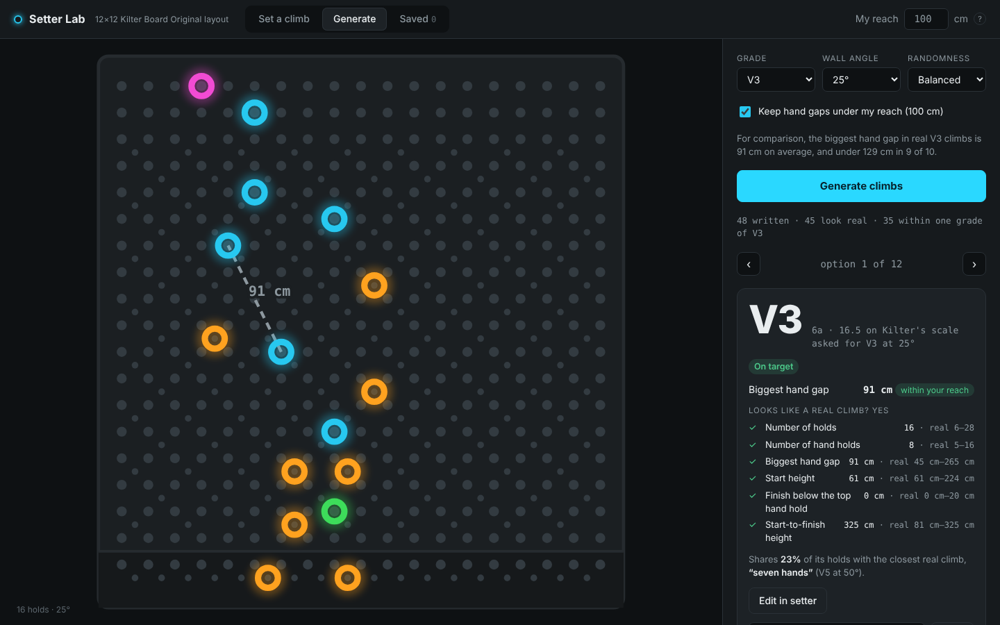

## Data

[Vilin97/KilterBoard](https://huggingface.co/datasets/Vilin97/KilterBoard) on
Hugging Face (MIT): one SQLite file with about 238k climb-angle pairs on the
Kilter Board Original, pre-split 80/10/10 by climb, plus the tables that map
holds to board positions.

Filters applied here: at least 3 ascents (fewer and the grade is noise), 1–2
start and 1–2 finish holds, no holds from other board types. That leaves
71,752 training, 8,673 validation and 8,759 test climbs. V11 and up are rare
(about 1,300 of 72k training climbs), so both parts are most reliable from V0
to V10.

Related work: [kilter-grading](https://github.com/Jorgeab01/kilter-grading)
trains a gradient-boosting grade predictor on the same file.

## Run it

Put `kilter_splits.sqlite` in this folder, then:

```bash
python3 -m venv .venv && source .venv/bin/activate
pip install -r requirements.txt

python prepare_data.py    # clean, decode and tokenize        (~15 s)
python train_boosting.py  # grade predictor 1                 (~1 min)
python train_gnn.py       # grade predictor 2   (~20 min; --epochs 5 to try it)
python compare.py         # results table and charts
python make_figures.py    # the board figures in Part 1

python train_generator.py     # climb generator (~55 min on 2 cores; faster on a laptop)
python evaluate_generator.py  # generate, check and grade ~3,500 climbs; Part 2 figures
```

`prepare_data.py --min-ascents 5` keeps only better-established grades (about
43k training climbs).

| File | What it does |
|---|---|
| `kilter/data.py` | load a split, decode holds, filter |
| `kilter/tokenizer.py` | climbs to tokens and back (for the generator) |
| `kilter/gpt.py`, `kilter/sampling.py` | the generator and rule-guided sampling |
| `kilter/climb_checks.py`, `kilter/critic.py` | plausibility and novelty checks; grading with the graph model |
| `kilter/grades.py` | numeric difficulty to V-grades, scoring |
| `kilter/features.py`, `kilter/hold_stats.py` | inputs for the boosting model |
| `kilter/graph.py` | climb to graph, and the graph network |
| `kilter/plot.py` | draw a climb in the app's LED colours |
| `prepare_data.py` | writes `data/processed/` |
| `train_boosting.py`, `train_gnn.py`, `train_generator.py` | train, score, save to `models/` |
| `evaluate_generator.py` | Part 2 results, figures and `results/generated_climbs.jsonl` |
| `app.py`, `app/index.html` | Setter Lab, the local app |
| `compare.py`, `make_figures.py` | charts and figures in `results/` |
| `show_climbs.py` | tokenizer round-trip check |
